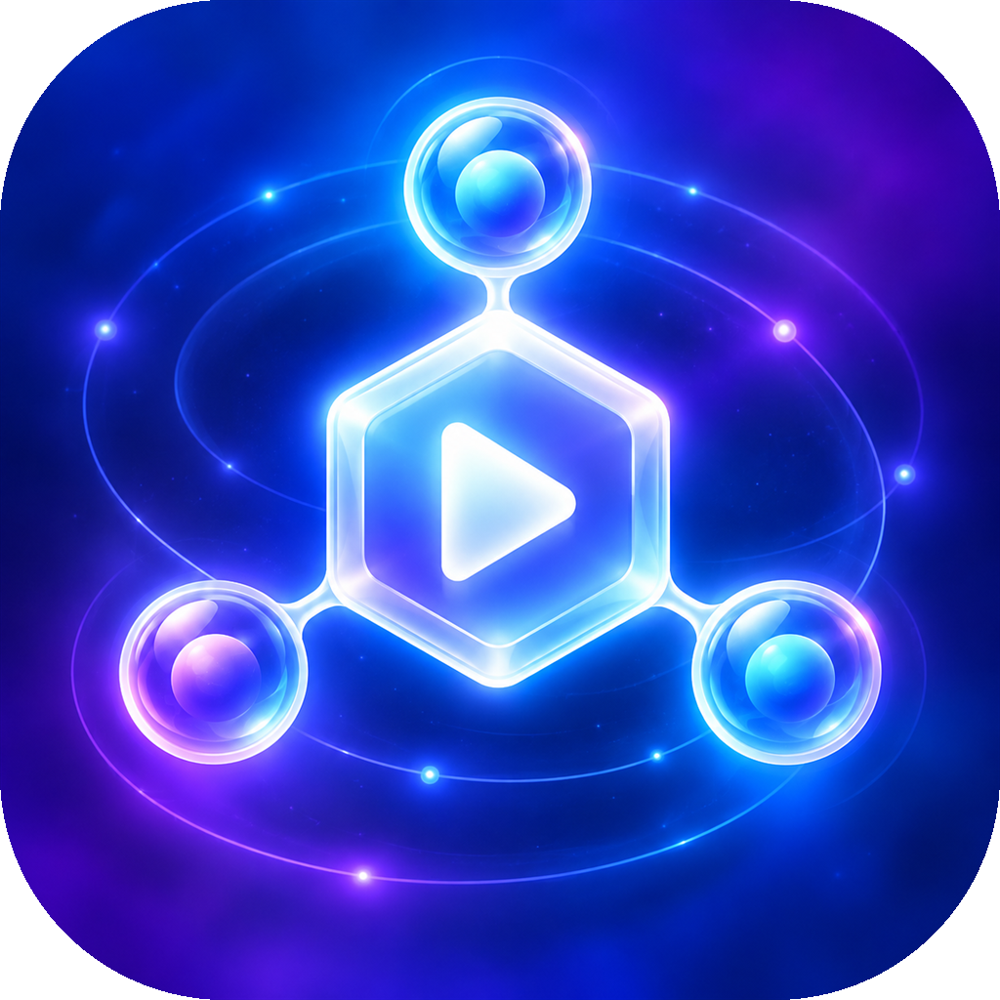
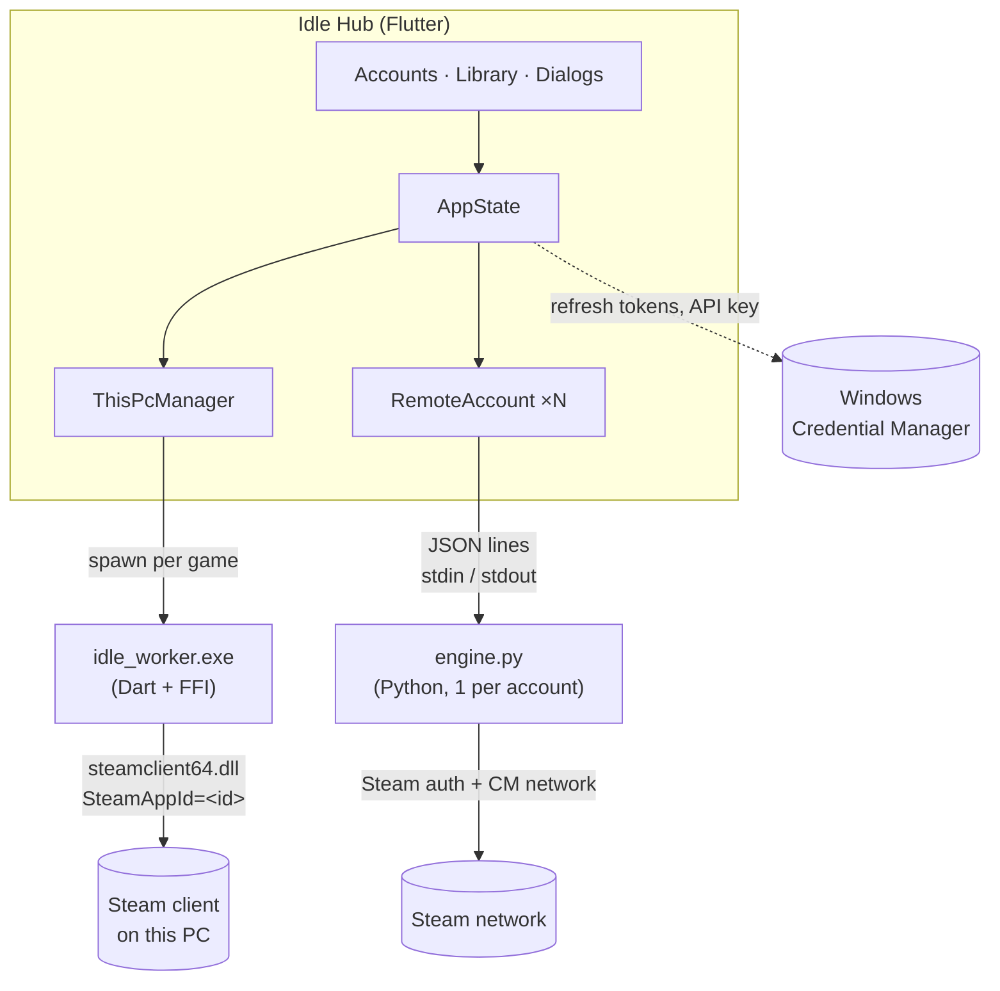

<div align="center">



# Idle Hub

**One place to boost playtime — for the account on this PC *and* for other accounts, without the Steam client.**


[Features](#-features) · [Install](#-install) · [Quick start](#-quick-start) · [Architecture](#-architecture) · [Security](#-security--privacy) · [FAQ](#-faq) · [Build](#-build-from-source) · [Türkçe özet](#-türkçe-özet)

</div>

---

## ✨ Features

| | |
|---|---|
| 🖥️ **This PC** | Boost any game for the account signed in to the Steam client — one tiny helper process per game, **no Python needed** |
| 👥 **Other accounts** | Add more accounts with a **QR code** or **username + password (+ Steam Guard)**. They idle through Steam's network, with no client running |
| ♻️ **Sessions survive restarts** | Accounts keep a saved login key (in Windows Credential Manager); games resume automatically — no password, no QR again |
| 📚 **Library with covers** | Installed games, your full library (optional free Web API key) or any game by AppID |
| ⚡ **Many games** | Up to 32 per account (Steam's limit) with live per-game timers |
| ⭐ **Favorites, search, tabs** | *Installed · Library · Favorites · Idling* tabs; search by name or AppID |
| 🧭 **Tray-first** | Close-to-tray, launch with Windows, start minimized, "Stop everything" from the tray menu |
| 🌍 **TR / EN** | Switch the language any time |

## 📦 Install

**Installer (recommended).** Download `IdleHub-Setup-<version>.exe` from [Releases](../../releases) and run it. It installs per-user
(no admin rights) and has a **prerequisite step**:

> ☑ *Install Python 3.12 and the required packages to idle other accounts* — checked by default, only needed for the
> **Other accounts** feature. The wizard installs Python (per-user, from python.org) only if it is not already present, then runs
> `pip install` for the engine. **"This PC" mode needs no Python at all.**
> The wizard also warns you if Steam is not installed.

**From source:** see [Build from source](#-build-from-source).

## 🚀 Quick start

### Boost games on *this PC*
1. Start Steam and sign in.
2. Open Idle Hub → select **This PC** (left) → press **Idle** next to a game.

### Add *another* account
1. Click **Add account**. Choose how to sign in:
   * **QR code** — open the Steam mobile app → *Steam Guard* → *Sign in with QR* → scan. No code needed.
   * **Password** — enter username and password; if asked, enter the Steam Guard code from your authenticator or e-mail.
2. Wait for **Online** (the library loads in the background), then press **Idle** on games.
3. That's it — the account keeps idling in the tray, and resumes after a restart.

If a session ever expires, the account shows **Sign-in needed** with a **Sign in again** button.

### Settings
Language · keep running in tray · launch with Windows · start minimized · optional **Steam Web API key** · *Network engine* status
(Python + packages, with a one-click *Install packages* button).

## 🏗 Architecture



| Piece | Responsibility |
|---|---|
| `worker/` (Dart, FFI) | Opens a Steam pipe with `SteamAppId=<id>`; Steam tracks the process as that app. One process per game (Steam locks the AppID per process) |
| `lib/engine/this_pc.dart` | Supervises workers, restarts them when Steam comes back |
| `engine/engine.py` (Python) | Signs in through Steam's *IAuthenticationService* (QR or credentials + Steam Guard), polls for the refresh token, logs on to the Steam network and sends `games_played`. Speaks JSON lines over stdin/stdout |
| `lib/engine/remote_account.dart` | Starts the engine, parses its events, forwards commands (login, guard code, set games) |
| `lib/data/store.dart` | `state.json` (no secrets) + Windows Credential Manager |

### Engine protocol (for contributors)

Commands (one JSON object per line, stdin): `login_password`, `login_qr`, `login_token`, `guard`, `set_games`, `quit`.
Events (stdout): `state` (`connecting · qr · need_2fa · need_email · need_confirm · wrong_code · logged_on · disconnected ·
bad_password · rate_limited · token_invalid · error`), `qr`, `identity`, `token`, `owned`. Details are documented at the top of
[`engine/engine.py`](engine/engine.py).

## 🔐 Security & privacy

* **Passwords** are sent only to Steam, held in memory during sign-in and **never written to disk**.
* **Session keys (refresh tokens)** and the **Web API key** are stored in **Windows Credential Manager** — not in any file, not in this repository.
* `state.json` (account names, favorites, custom games) lives in `%APPDATA%\IdleHub\` and contains **no secrets**.
* The engine's log file contains no credentials.
* No telemetry, no analytics, no third-party servers — only Steam and Steam's image CDN.

> ⚠️ Anyone with access to your Windows user session can use saved sessions, like with any "remember me" login. Remove an account
> in the app to delete its stored key.

## ❓ FAQ

<details><summary><b>Do I need Python?</b></summary>
Only for <b>Other accounts</b>. <b>This PC</b> mode runs on compiled Dart helpers. The installer can set Python up for you.
</details>

<details><summary><b>Is my password stored?</b></summary>
No. After signing in, only a revocable <i>refresh token</i> is stored (Credential Manager). You can revoke all sessions from
Steam → <i>Settings → Security → Manage Steam Guard</i>.
</details>

<details><summary><b>The QR never finishes / password says "wrong"</b></summary>
Check your clock, try again after a minute (Steam rate-limits repeated attempts) and make sure the account has Steam Guard
configured in the mobile app.
</details>

<details><summary><b>Can two things idle the same account?</b></summary>
Steam allows one "playing" session per account per login. If you start the real game or Steam elsewhere, Steam may kick the idle
session; Idle Hub reconnects automatically when possible.
</details>

<details><summary><b>Is it allowed?</b></summary>
Not endorsed by Valve; it may conflict with the Steam Subscriber Agreement or game rules. Use it at your own risk and only with
accounts you own.
</details>

## 🔧 Build from source

Requirements: [Flutter](https://docs.flutter.dev/get-started/install/windows) (Windows desktop), Visual Studio **Desktop development
with C++**. For *Other accounts*: Python 3.9+.

```powershell
git clone https://github.com/GingerSugar06/IdleHub.git
cd IdleHub
flutter pub get
flutter test
powershell -ExecutionPolicy Bypass -File tool\build.ps1     # worker + app + engine\ → build\windows\x64\runner\Release\
```

Engine packages (`pip install -r engine\requirements.txt`): `steam[client]`, `protobuf<3.21`, `requests`, `pycryptodomex`.
Quick self-check: `python engine\engine.py --check`.

**Installer:** `powershell -ExecutionPolicy Bypass -File tool\make_installer.ps1` (needs
[Inno Setup 6](https://jrsoftware.org/isinfo.php); downloads the Python installer to embed it).
**Icon:** edit `assets/icon/app_icon.svg` or drop `assets/icon/source.png`, then `python tool/make_icon.py`.

### Project layout

```
IdleHub/
├─ worker/            steam_worker package: Steam session layer + idle_worker.exe source
├─ engine/            engine.py (Python network engine) + requirements.txt
├─ lib/
│  ├─ main.dart       window, tray, single instance
│  ├─ engine/         this_pc.dart, remote_account.dart (+ Python locator / installer)
│  ├─ steam/          library scan (appmanifest, VDF), Steam user, Web API
│  ├─ state/          AppState
│  ├─ data/           store.dart (JSON + secure storage)
│  ├─ core/           theme, l10n (TR/EN), autostart
│  └─ ui/             shell, library, dialogs (add account, settings)
├─ installer/         Inno Setup script (Python prerequisite step)
└─ tool/              build.ps1, make_installer.ps1, make_icon.py
```

## 🤝 Contributing

Issues and PRs are welcome. Please run `flutter analyze` and `flutter test`. **Never commit tokens, API keys or `state.json`.**

## 🇹🇷 Türkçe özet

**Idle Hub**, hem bu bilgisayardaki Steam hesabı hem de **başka hesaplar** (Steam istemcisi açık olmadan) için oyun saati kasar.
"Bu bilgisayar" modu Python gerektirmez; başka hesap eklemek için QR kod ya da şifre + Steam Guard kullanılır ve küçük bir Python
motoru çalışır — kurulum sihirbazı Python'u ve paketleri senin için kurabilir. Şifren diske yazılmaz; oturum anahtarları Windows
Kimlik Bilgisi Yöneticisi'nde saklanır, hesaplar uygulama yeniden açılınca kendiliğinden devam eder.

## ⚖️ License & disclaimer

[MIT](LICENSE). Fonts: Poppins, IBM Plex Mono (SIL OFL 1.1). Unofficial project, **not affiliated with Valve**; "Steam" is a
trademark of Valve Corporation. Boosting playtime may violate the Steam Subscriber Agreement or a game's rules — use at your own risk.
